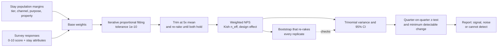

# surveyrake

[](https://github.com/SlateGitOrg/surveyrake/actions/workflows/ci.yml)


surveyrake turns hotel guest survey responses into a Net Promoter Score that can be compared across properties and quarters. It rakes respondents to the known stay population (loyalty tier, booking channel, trip purpose, property), reports each property's score with a trinomial variance and Kish design effect, checks that variance against a bootstrap that re-rakes every replicate, and labels each quarter-on-quarter move `signal`, `noise` or `cannot detect` using the minimum change the sample could have seen. All data is synthetic and generated by the repository, so every estimate can be scored against the true population NPS.

## The problem

A hotel group surveys guests after checkout and reports NPS by property every quarter. Loyalty members answer several times as often as other guests and score higher, so the raw score flatters the brand and moves with who replied. Property managers are then praised or questioned for quarter-on-quarter swings that sit inside sampling noise, and a small property's score says almost nothing about whether anything changed. The stay population is known exactly from the property-management system; the survey is not a random sample of it. Weighting the respondents back to the known margins fixes the composition, and the weights have a cost in effective sample size that has to be carried into every confidence interval and every change test.

## How it works



- `surveyrake.synth` generates every stay and every guest's latent 0-10 score, then draws who responds.
- `surveyrake.rake` fits weights so the weighted count in each category of each margin equals the population count, trims at 5x the mean weight and re-rakes until both the margins and the cap hold. A margin category with stays but no respondents raises an error that names the variable and category and suggests a collapse.
- `surveyrake.nps` computes weighted promoter, passive and detractor shares, the Kish effective sample size `n_eff = (sum w)^2 / sum w^2`, the design effect `n / n_eff`, the trinomial variance `(p_P + p_D - (p_P - p_D)^2) / n_eff`, and a seeded bootstrap (default 500 replicates) that re-rakes each replicate.
- `surveyrake.compare` runs z-tests on independent weighted estimates (quarter against quarter, property against the rest of the group), computes the minimum detectable change of the quarter-on-quarter difference at 80% power and 5% significance, and can apply a Holm correction across properties.
- `surveyrake.report` writes the Markdown tables shown below.

## Quick start

Python 3.11 or newer.

```bash
python -m venv .venv && . .venv/bin/activate
pip install -e ".[dev]"

surveyrake generate --out data
surveyrake rake --data data --margins tier,channel,purpose,property
surveyrake nps --data data --by property --quarter 2025-Q2
surveyrake compare --data data --from 2025-Q1 --to 2025-Q2          # add --holm for corrected verdicts
surveyrake diagnostics --data data
```

`generate` writes `population.csv` (stay counts per cell, the property-management extract), `responses.csv` (one row per respondent) and `truth.csv` (the true population NPS, read only by `diagnostics` to score the method). `nps` also accepts `--bootstrap 500` for a re-raking bootstrap standard error and `--by tier|channel|purpose|group`. `rake --out weights.csv` writes the raked weight for every respondent.

## Example output

The data is synthetic: 12 properties, two quarters, about 48,000 stays per quarter and about 4,800 responses per quarter. The output below was produced by the commands above with the default seeds.

Property table for 2025-Q2 with change against 2025-Q1 (`surveyrake compare`). In the injected truth, P07 falls from 35.3 to 16.0 (about 20 points) and P03 does not move (-0.8 to 1.1, sampling noise of a 1,200-stay property).

| Property | Responses | Raw NPS | Raked NPS |        95% CI | n_eff | Design effect |  MDE | Change vs 2025-Q1 |       Verdict |
| -------- | --------: | ------: | --------: | ------------: | ----: | ------------: | ---: | ----------------: | ------------: |
| P01      |       280 |    31.8 |      19.7 |   [7.5, 31.8] |   178 |          1.58 | 24.0 |              +4.3 | cannot detect |
| P02      |       403 |    53.6 |      41.4 |  [32.4, 50.5] |   248 |          1.62 | 19.3 |              +3.1 |         noise |
| P03      |       120 |     8.3 |       4.1 | [-13.1, 21.2] |    76 |          1.58 | 35.0 |              -6.6 | cannot detect |
| P04      |       349 |    47.6 |      37.0 |  [27.0, 47.0] |   213 |          1.64 | 20.5 |              +4.9 | cannot detect |
| P05      |       437 |    60.6 |      51.1 |  [42.4, 59.7] |   270 |          1.62 | 16.4 |              -6.4 |         noise |
| P06      |       311 |    -0.6 |      -9.2 |  [-20.7, 2.3] |   201 |          1.55 | 22.9 |              -8.2 | cannot detect |
| P07      |       932 |    29.2 |      16.7 |  [10.3, 23.2] |   577 |          1.62 | 12.8 |             -16.6 |        signal |
| P08      |       368 |    53.8 |      48.3 |  [39.2, 57.4] |   228 |          1.61 | 18.4 |              +1.1 |         noise |
| P09      |       403 |    30.3 |      14.4 |   [4.2, 24.6] |   254 |          1.59 | 19.9 |              -2.5 |         noise |
| P10      |       442 |    56.6 |      48.0 |  [39.8, 56.1] |   274 |          1.61 | 16.2 |              -5.7 |         noise |
| P11      |       255 |    -0.8 |     -15.5 | [-28.2, -2.8] |   160 |          1.59 | 25.3 |              +1.6 | cannot detect |
| P12      |       456 |    38.6 |      26.1 |  [17.2, 35.0] |   284 |          1.60 | 17.8 |              -9.3 |         noise |
| Group    |     4,756 |    37.0 |      25.2 |  [22.3, 28.1] | 2,958 |          1.61 |  5.7 |              -5.1 |        signal |

MDE is the minimum detectable change of the quarter-on-quarter difference: it uses both quarters' variances, so it is the smallest true change that would be flagged with 80% power at 5% significance, not a property of one quarter's interval. `signal` means the change is significant at 5%. `noise` means it is not, and a 20-point move would have been detected (MDE at or below 20). `cannot detect` means it is not significant and the MDE is above 20 points, so the sample cannot tell. P07 is called a signal; P03 has an MDE of 35 points, so its observed -6.6 says nothing either way.

Raking diagnostics (`surveyrake diagnostics`). Margin error is the largest gap between a weighted category count and its population count, as a share of the population.

| Quarter | Iterations | Trim rounds | Max margin error | Design effect | Weight range (x mean) | Converged |
| ------- | ---------: | ----------: | ---------------: | ------------: | --------------------: | --------: |
| 2025-Q1 |          7 |           0 |          2.4e-11 |          1.63 |          0.30 to 3.11 |       yes |
| 2025-Q2 |          7 |           0 |          2.9e-11 |          1.61 |          0.31 to 3.16 |       yes |

The analytic trinomial standard error of the group NPS against the re-raking bootstrap (500 replicates):

| Quarter | Trinomial SE | Bootstrap SE | Ratio |
| ------- | -----------: | -----------: | ----: |
| 2025-Q1 |        1.425 |        1.382 |  0.97 |
| 2025-Q2 |        1.462 |        1.437 |  0.98 |

Group raw against raked against the true population NPS, in points:

| Quarter | Raw NPS | Raked NPS | True NPS | Raw error | Raked error |
| ------- | ------: | --------: | -------: | --------: | ----------: |
| 2025-Q1 |    40.4 |      30.3 |     28.6 |     +11.8 |        +1.7 |
| 2025-Q2 |    37.0 |      25.2 |     24.5 |     +12.5 |        +0.7 |
| pooled  |    38.7 |      27.7 |     26.6 |     +12.2 |        +1.2 |

Raking removes about 11 of the 12 points the raw score overstates. The remaining 0.7 to 1.7 points are about one standard error of the estimate (1.4 to 1.5 points).

## Design decisions

- **Rake on margins, not cells.** The population is known by cell, but the response mechanism in the generator is log-linear in main effects, and raking to one-dimensional margins matches that model without needing every tier x channel x purpose x property cell to have respondents. The cost is that a real survey with an interaction in response propensity (for example loyalty members answering more on direct bookings only) would not be fully corrected.
- **Trinomial variance with the Kish design effect.** The variance of NPS for a ratio of weighted counts is approximated as `(p_P + p_D - (p_P - p_D)^2) / n_eff`. It ignores any correlation between weight and outcome and treats the sample as independent draws, so it should run slightly wide here, and a test measures that: over 200 simulated surveys of the same 2025-Q1 population the trinomial 95% interval covers the true NPS in 97.5% of runs (unweighted: 0%), and the standard deviation of the raked estimate across those surveys is 1.32 points against a mean analytic SE of 1.47, a ratio of 0.90 (the test asserts 0.80 to 1.00). A bootstrap that re-rakes each replicate is provided as a second check rather than as the default interval, because it costs seconds instead of milliseconds.
- **Trim-rake loop with a reported failure mode.** Weights above 5x the mean are cut to the cap and the data are raked again until both conditions hold. With these margins the largest raked weight is about 3x the mean, so the cap does not bind on the default data; tests lower the cap to exercise it. If the margins and the cap cannot both hold the result is returned with `converged = False` and a message rather than a silently wrong weight set.
- **Property against the rest of the group, not against the group.** A property is part of the group, so comparing the two is not a test of independent estimates and understates the standard error of the difference. Each property is compared with every other respondent instead. The two sides still come from one rake (the weights share the same margins), so they are treated as independent although they are not exactly; the dependence is small for one property out of twelve but the p-values are approximate.
- **Three verdicts, with a configurable practical size.** A significant change is a `signal`. A non-significant change is `noise` only when the test had the power to see a move of `--practical` points (default 20); otherwise it is `cannot detect`. The default is a judgement about what a hotel group would act on, and the alternative of calling every non-significant change noise would tell the manager of a 120-response property that nothing changed when the survey could not have shown it.
- **Per-property verdicts, with an optional Holm correction.** By default each property is tested at 5% on its own, as a property manager would read it, so verdicts are uncorrected. Over 60 simulated surveys of the same population, 5.8% of the 660 tests of the 11 properties whose true change is about zero came out `signal`, and at least one of them did in 48% of surveys. `compare --holm` adds a second verdict column after Holm adjustment across properties: in the same 60 surveys that cut false signals to 1.1% of tests. The example output is one fixed seed (population seed 2025, response seed 2) on which only P07 is flagged; other seeds often flag an extra property, and the tests therefore assert only what is robust (P07 flagged, P03 not flagged, false-flag rate near 5%).

## Testing

```bash
pytest -q
ruff check . && ruff format --check .
```

The suite has 79 tests and runs offline in a few seconds. Raking tests assert margins within 1e-8 of target, weights summing to the population, the 5x cap with margins within 1e-6, a lower cap that does bind, the empty-category error, and Hypothesis properties (scaling base weights leaves raked weights unchanged; margins that already hold come back unchanged after one iteration). Variance tests use the fixtures `p_P = 0.5, p_D = 0.2, n = 100` (NPS 30, SE 7.810 points) and weights `[1, 1, 2, 4]` (`n_eff` = 2.909). Acceptance tests score the method against the generator's truth: pooled raked NPS within 3 points while raw is off by at least 8, 200 simulated surveys with the trinomial interval covering 90-99.5% of the time and the unweighted interval under 50%, a bootstrap-to-analytic standard error ratio inside [0.7, 1.3], P07's drop called a signal and P03's change not flagged with an MDE above 15 points (for several response seeds, not only the default), a false-flag rate near 5% per unchanged property over 60 seeds with Holm flagging fewer, and a measured ratio of the estimator's spread to the analytic SE between 0.80 and 1.00.

## Project layout

```
src/surveyrake/
  synth.py      seeded stays, latent scores, response mechanism, true NPS
  data.py       CSV reading and writing
  rake.py       iterative proportional fitting, trim-rake loop, convergence report
  nps.py        weighted NPS, n_eff, design effect, trinomial variance, bootstrap
  compare.py    z-tests, minimum detectable change, verdicts, property vs rest
  report.py     Markdown tables
  pipeline.py   rake each quarter to its own population
  cli.py        typer commands: generate, rake, nps, compare, diagnostics
tests/          rake, nps, compare, synth, acceptance and CLI tests
.github/workflows/ci.yml
```

## License

MIT. See `LICENSE`.
